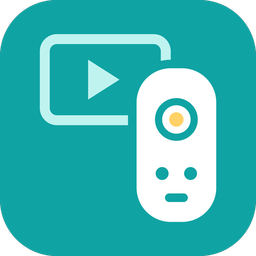
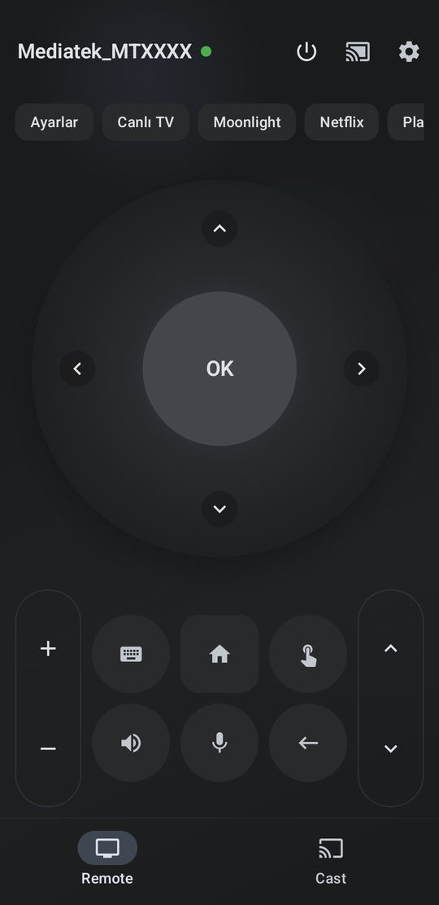
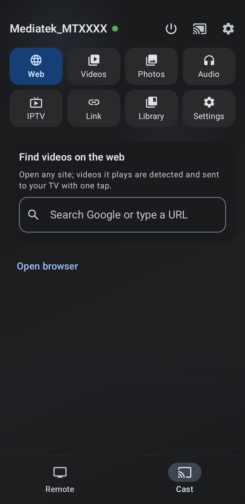
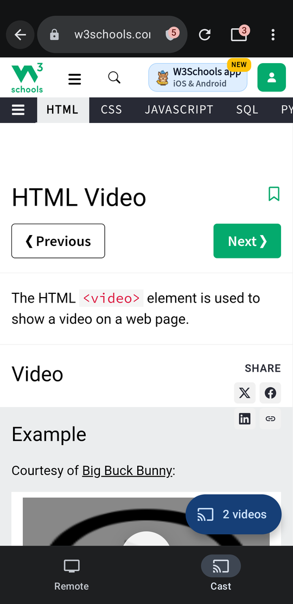
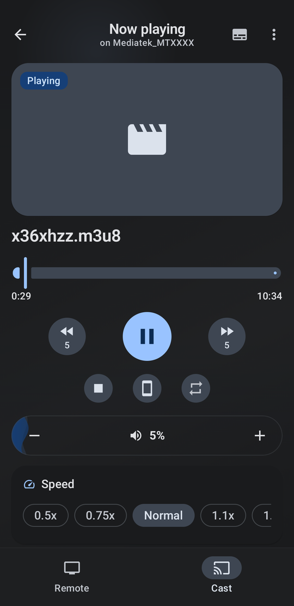

<p align="center">
  
</p>

<h1 align="center">TV Remote &amp; Cast</h1>

<p align="center">
  Your Android TV remote and a cast hub in one app.<br>
  Free, no ads, no accounts, no tracking.
</p>

<p align="center">
  <a href="https://github.com/canasnn/tv-remote-cast/releases/latest"></a>
  <a href="LICENSE"></a>
  
  
</p>

<p align="center">
  
  
  
  
</p>

## What it is

Two apps that work together:

| | |
|---|---|
| **TV Remote &amp; Cast** (phone) | A full remote for any Android TV / Google TV, and a cast hub: a browser that finds the videos on web pages, IPTV lists, your photos, music and files. |
| **TV Receiver** (TV) | A small player for the TV. It has no icon and stays out of sight; when you cast, the video simply starts on the TV. It also tells the phone which apps the TV has. |

No Chromecast and no ADB needed: the remote uses the TV's own remote protocol, and casting goes to the receiver over your Wi-Fi.

## Features

**Remote**
- Finds the TVs on your Wi-Fi by itself, wakes a TV from standby and reconnects to the last one.
- D-pad, touchpad and number pad; volume, mute, channel, power, Home, Back and voice search.
- Keyboard that types straight into the TV's text box, in any language.
- Your TV's apps one tap away, custom shortcuts, a layout you can rearrange.
- Material You colours and a pure-black AMOLED theme.

**Cast**
- **Browser** that finds the videos on a page (HLS, DASH, MP4 and players inside pages), with a quality picker, tabs and private tabs, bookmarks, history and your choice of search engine.
- **Ad blocking** with a worldwide block list that stays up to date by itself, plus pop-up and redirect blocking.
- **IPTV**: M3U, W3U and RSS lists with groups, search and favourites; lists refresh automatically; channel up/down from the phone.
- **Your phone's files**: videos, photos (slideshow), music, folders, or any file you pick or share from another app.
- **Subtitles** from the page, files (SRT, VTT, ASS), links or OpenSubtitles.com; timing and full style settings.
- **Now playing**: seek, skip, speed, audio and subtitle tracks, the remote's volume control, repeat, queue, rotate and zoom; notification and lock-screen controls.
- **Playlists**, **downloads** (streams saved as MP4), a **phone player** with gestures and picture-in-picture, and **backup / restore**.

## Install

1. Download `TV-Remote-and-Cast.apk` and `TV-Receiver.apk` from the [latest release](https://github.com/canasnn/tv-remote-cast/releases/latest).
2. **Phone:** open `TV-Remote-and-Cast.apk` and allow installing from your browser or file manager.
3. **TV (once):** install `TV-Receiver.apk` on the TV. The easiest way is the free *Downloader* app from the TV's Play Store: open it, enter the link of `TV-Receiver.apk` from the release page and install. You can also use `adb install TV-Receiver.apk`.
4. Open the phone app, pick your TV and enter the code the TV shows. Done: from now on the phone starts the receiver by itself.

The phone and the TV need to be on the same Wi-Fi.

## Building from source

Requirements: JDK 21 and the Android SDK (or Android Studio).

```bash
git clone https://github.com/canasnn/tv-remote-cast.git
cd tv-remote-cast
./gradlew :app:assembleDebug        # phone app
./gradlew :receiver:assembleDebug   # TV receiver
./gradlew :castcore:test :protocol:test :app:testDebugUnitTest
```

Release builds are signed when `TVREMOTE_STORE_FILE`, `TVREMOTE_STORE_PASSWORD`, `TVREMOTE_KEY_ALIAS` and `TVREMOTE_KEY_PASSWORD` are set in `~/.gradle/gradle.properties`; otherwise `assembleRelease` makes unsigned APKs.

| Module | Contents |
|---|---|
| `app/` | Phone app (Kotlin, Jetpack Compose). `androidLib/` is the Android TV remote protocol, `cast/` the cast hub. |
| `receiver/` | TV receiver (Media3 player with FFmpeg audio, control server, TV app list). |
| `protocol/` | Messages between the phone and the receiver. |
| `castcore/` | Video detection, IPTV parsing, subtitles, library and settings; unit tested. |
| `ConnectSDK/` | Network device discovery. |

## Privacy

The app sends nothing to us: no analytics, no crash reports, no accounts. It talks to your TV, to the sites you open, to the ad-block list it keeps up to date, and to OpenSubtitles.com only if you use it.

## License

- Phone app, `protocol/` and `castcore/`: [Apache License 2.0](LICENSE).
- TV receiver: GNU GPL v3.0, because it includes the FFmpeg audio decoder.

Third-party notices are in [NOTICE](NOTICE). Bugs and ideas: [issues](https://github.com/canasnn/tv-remote-cast/issues).
